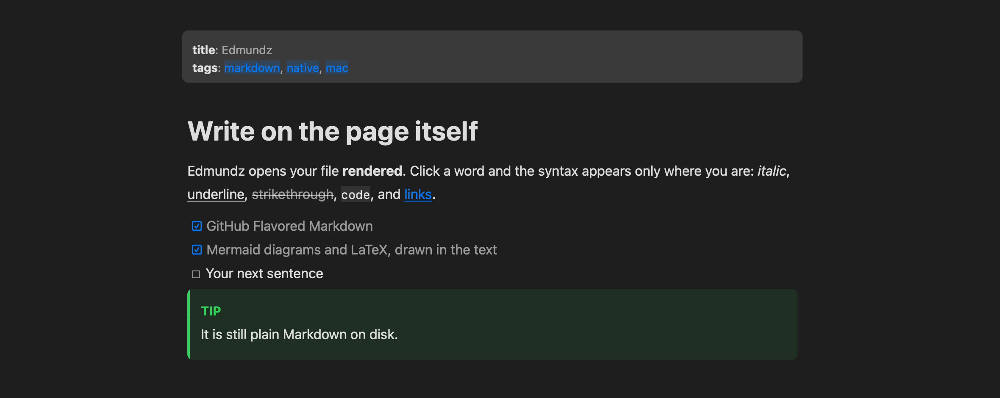
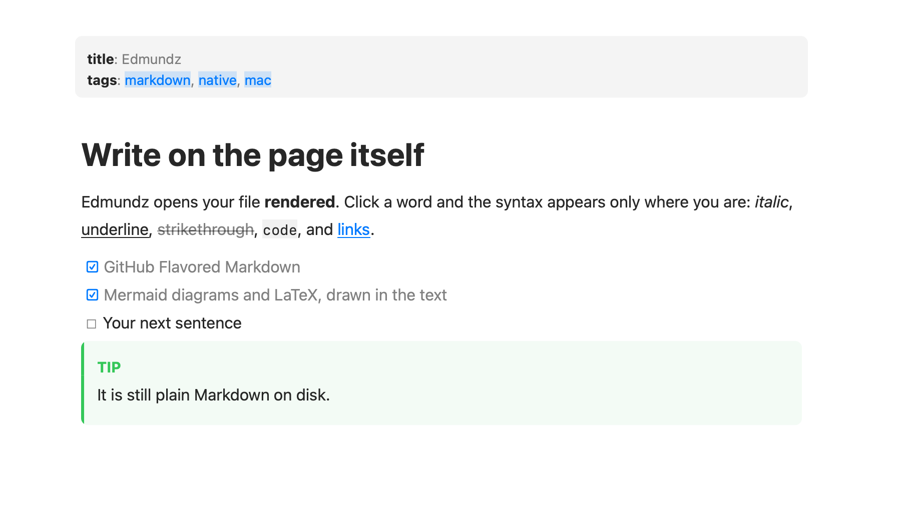
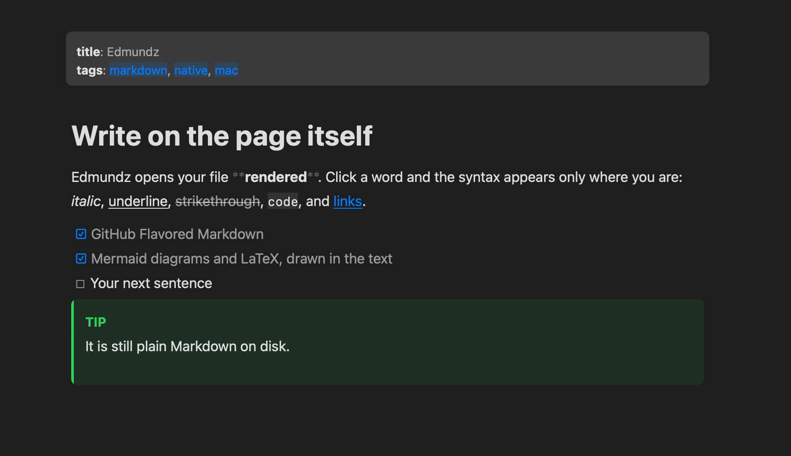
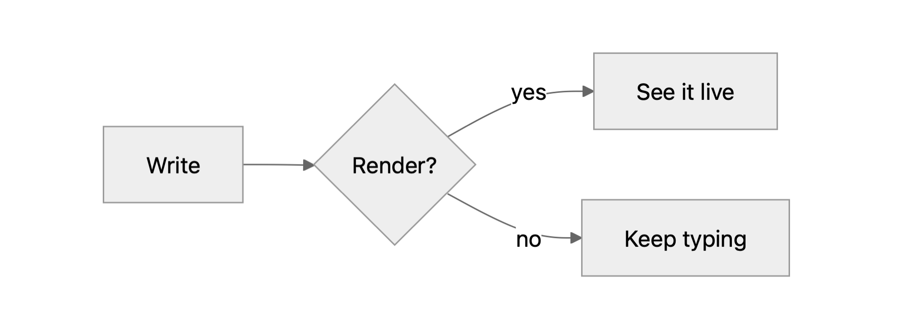
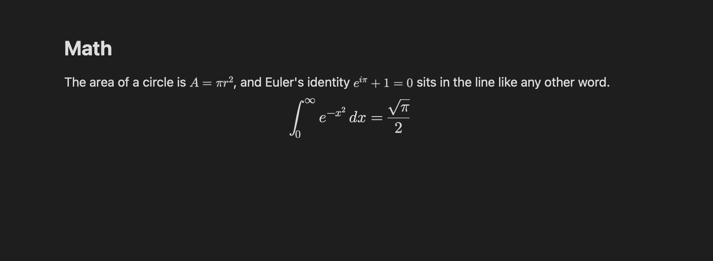
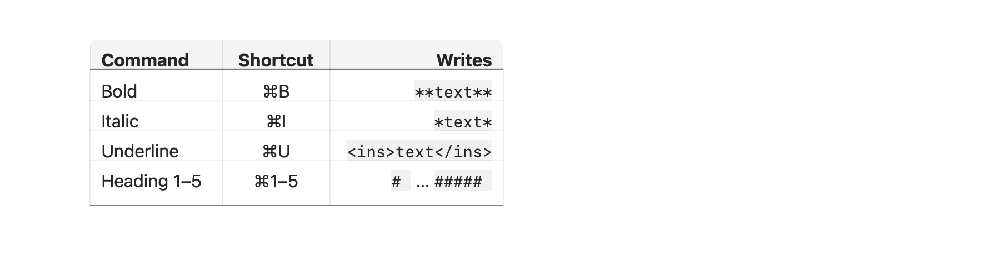
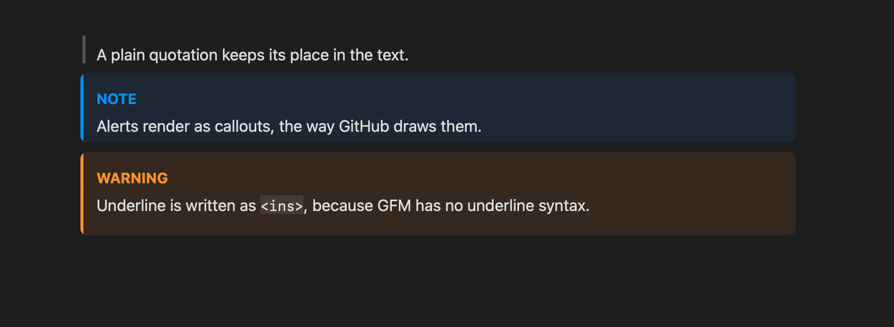

<p align="center">
  <a href="https://github.com/jaydenrasmussen/Edmundz/releases/latest" title="Download the latest release">
    
  </a>
</p>

<p align="center">
  A Markdown editor where the page is the editor.<br>
  Your file opens rendered. Click a word and the syntax appears only where you are. GitHub Flavored Markdown, Mermaid, LaTeX and images, in a native Mac app that idles at 0% CPU.
</p>

<p align="center">
  <a href="https://github.com/jaydenrasmussen/Edmundz/releases/latest"></a>
  <a href="https://github.com/jaydenrasmussen/Edmundz/actions/workflows/ci.yml"></a>
  
  <a href="LICENSE"></a>
</p>

<p align="center">
  <b><a href="https://github.com/jaydenrasmussen/Edmundz/releases/latest">Download</a></b> ·
  <b><a href="#features">Features</a></b> ·
  <b><a href="#install">Install</a></b> ·
  <b><a href="#build">Build</a></b> ·
  <b><a href="https://github.com/jaydenrasmussen/Edmundz/releases">Changelog</a></b>
</p>

## Features

- **One surface, always rendered:** headings, bold, lists, tables, code, math, diagrams and images are drawn while you edit. The raw syntax shows only for the element your caret is in, and a document opens with no caret at all.
- **Keyboard first:** `⌘B` bold, `⌘I` italic, `⌘U` underline, `⌘1`–`⌘5` headings, `⌘K` link, `⇧⌘9` task list, `⌘]` and `⌘[` to indent. Each one toggles, and Return continues a list. Underline is written as `<ins>`, since GFM has no underline syntax.
- **GitHub Flavored Markdown:** tables with alignment and column lines, task lists you can tick with a click, strikethrough, autolinks, footnotes, alerts (`> [!NOTE]`), emoji shortcodes, `<details>` that collapse, and a front-matter card.
- **Diagrams and math:** Mermaid diagrams and LaTeX (`$…$`, `$$…$$`) are drawn in the text. Math is rendered natively, with KaTeX as a fallback for what it cannot draw; the diagram renderer starts only when a diagram needs it and is released after.
- **Images:** shown in the text where you wrote them, sized with `{width=300}`. Paste or drop one and it is saved next to the document with the link written for you.
- **Links that work:** click a link to open it, a footnote number to jump to its note, a heading link to scroll to it.
- **Your fonts:** any installed font for the body, headings and code, plus size, line height and column width. A document can set its own with `font:` in the front-matter.
- **Plain files:** a document you did not change saves byte for byte. It reloads when something else edits the file, and asks first if you have unsaved changes. Copy and cut put Markdown source on the clipboard. Export to PDF or HTML.
- **Fast and small:** a 1 MB file opens in about 40 ms, a keystroke takes about 2 ms, and it idles at 0.1% CPU in about 45 MB. Measured on an M2 Pro; the budgets are enforced by `task bench`.
- **Native:** AppKit and TextKit 2, a Quick Look preview extension, and Light and Dark that follow the system.

<details open>
<summary><h2>Screenshots</h2></summary>

<p align="center">
  
  &nbsp;
  
</p>
<p align="center">
  
  &nbsp;
  
</p>
<p align="center">
  
  &nbsp;
  
</p>
</details>

## Install

**Requirements:** macOS 26 and an Apple silicon Mac.

### From a release

1. Download `Edmundz-<version>.dmg` from the [latest release](https://github.com/jaydenrasmussen/Edmundz/releases/latest) and check it against `SHA256SUMS.txt`:
   ```sh
   shasum -a 256 -c SHA256SUMS.txt --ignore-missing
   ```
2. Open the disk image and drag **Edmundz** to Applications.
3. Open a Markdown file with it. To make it the default, choose a `.md` file in Finder → Get Info → Open with → Edmundz → Change All.

> [!NOTE]
> Releases built without signing credentials are ad-hoc signed and not notarized. If macOS blocks the first launch, Control-click the app and choose **Open**, or clear the quarantine flag:
> ```sh
> xattr -dr com.apple.quarantine /Applications/Edmundz.app
> ```

### Homebrew

```sh
brew tap jaydenrasmussen/edmundz https://github.com/jaydenrasmussen/Edmundz
brew install --cask edmundz
```

If macOS blocks the first launch, use the `xattr` command above.

### From source

Needs Swift 6.2 and [Task](https://taskfile.dev) (see [Build](#build)).

```sh
git clone https://github.com/jaydenrasmussen/Edmundz.git
cd Edmundz
task bundle
cp -R build/Edmundz.app /Applications/
```

### Update and uninstall

To update, replace `Edmundz.app` in Applications with the new version, or run `brew upgrade --cask edmundz`. To uninstall, drag it to the Trash, or run `brew uninstall --cask --zap edmundz`.

## Build

Needs Swift 6.2 and [Task](https://taskfile.dev).

```sh
task            # list tasks
task test       # unit tests
task bench      # performance gates and behavior checks (fails on a miss)
task check      # tests + bench
task bundle     # build/Edmundz.app (direct channel, ad-hoc signed)
task run -- examples/sample.md
```

Mermaid and KaTeX are downloaded once into `Resources/` by `task vendor` (`task bundle` runs it when they are missing).
`task bundle:mas` builds the Mac App Store variant (sandbox entitlements, no Sparkle), `task dmg` makes a disk image, and
`task notarize` signs and notarizes the direct build.

## Releases

Releases are cut from GitHub, not from a laptop:

1. Open **Actions → Cut release → Run workflow** and choose **patch**, **minor** or **major**.
2. The workflow works out the next `vX.Y.Z` from the latest tag, tags the current commit, and creates the GitHub release with
   automatically generated notes (grouped by PR label; see `.github/release.yml`).
3. It then builds the app and attaches `Edmundz-X.Y.Z.dmg`, `Edmundz-X.Y.Z-macOS.zip` and `SHA256SUMS.txt` to the release.

Publishing a release by hand in the GitHub UI runs the same build. `CI` builds and tests every push and pull request.

To sign and notarize, add these repository secrets:

| Secret | What it is |
|---|---|
| `BUILD_CERTIFICATE_BASE64` | Developer ID Application certificate (.p12), base64-encoded |
| `P12_PASSWORD` | password of that .p12 |
| `KEYCHAIN_PASSWORD` | any password for the temporary CI keychain |
| `DEVELOPER_ID` | the identity name, e.g. `Developer ID Application: Name (TEAMID)` |
| `APPLE_ID`, `APPLE_TEAM_ID`, `APPLE_APP_PASSWORD` | notarization credentials (an app-specific password) |

Set `SUFeedURL` and `SUPublicEDKey` in `scripts/bundle.sh` to enable Sparkle updates in the direct build.

## Known limitations

- Performance is measured on an M2 Pro, not yet on an M1 with 8 GB.
- Hard-wrapped paragraphs show their source line breaks: each source line is laid out as its own block, so lines cannot reflow.
- Code highlighting is a small built-in tokenizer, not a grammar-based one.
- The Quick Look extension is built and registered but has not been verified in Finder.
- IME and VoiceOver are covered by programmatic checks, not by a session with a real input method or screen reader.

## License

[MIT](LICENSE). Third-party software is listed in the About window and in `Resources/licenses`.
