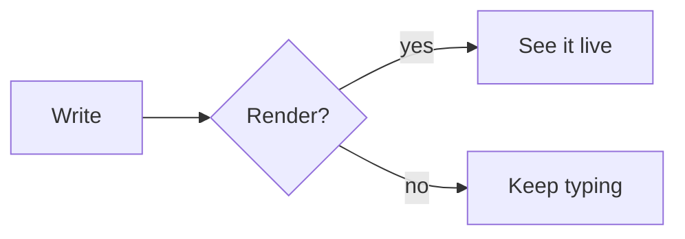

# Edmundz

A **live-rendered** editor: *italic*, <ins>underline</ins>, ~~strikethrough~~, `inline code`, and a [link](https://example.com).
Hard-wrapped paragraphs keep **bold that
continues onto the next line** correctly. Emoji work too :tada: and footnotes[^1].

## Lists and tasks

- A bullet with **bold**
  - A nested bullet
- [ ] An open task
- [x] A finished task

1. First
2. Second

> A quotation with *emphasis*.

> [!NOTE]
> Alerts render as callouts.

### Table

| Name | Role | Score |
|:-----|:----:|------:|
| Ada | Engineer | 10 |
| Grace Hopper | Admiral | 9000 |

---

## Code

```swift
struct Point { let x: Int; var y: Double }  // a comment
let p = Point(x: 1, y: "two".count > 2 ? 3.5 : 0)
```

## Math

Inline $E = mc^2$ and $a_i^2 + b_i^2 = c_i^2$, currency like $5 and $10 stays text.

$$
\int_0^\infty e^{-x^2}\,dx = \frac{\sqrt{\pi}}{2}
$$

A formula needing the fallback: $\underbrace{a+b}_{n}$.

## Diagram



## Details

<details>
<summary>Click to expand</summary>

Hidden content with **bold** and a list:

- one
- two

</details>

## Image

{width=1000}

Text after the image with a [heading link](#math).

[^1]: Footnote text.
